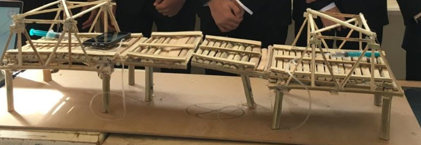
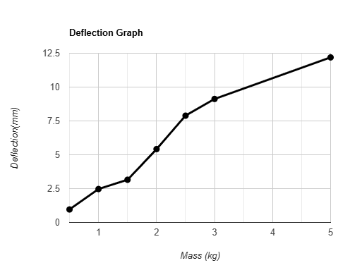
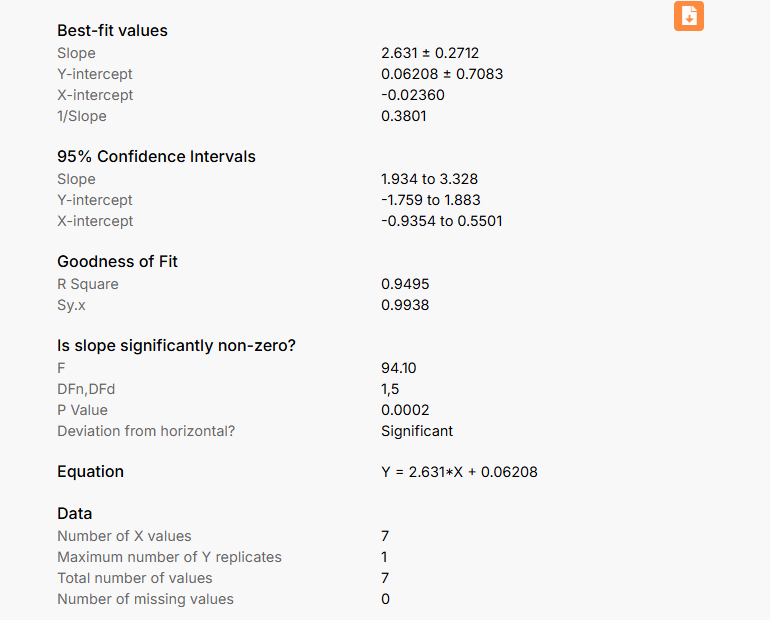

<h1 align="center">The Hydroscule Bridge</h1>

--------------------------
---------------------------------
### A 1:50 scale vertical warren truss swing bridge designed for the Ismailia Canal, with a center-bearing mechanism that rotates the span open for water traffic. The deck deflection was measured with a motion sensor under loads up to 5 kg and fit with linear regression. Built as a capstone project for STEM High School for Boys - 6th of October.

### 
[Main Features](#main-features) **-** [The Capstone](#the-capstone) **-** [Problem](#the-problem) **-** [Design Requirements](#design-requirements) **-** [Prior Solutions](#prior-solutions) **-** [Prototype](#the-prototype) **-** [Testing](#testing) **-** [Files](#whats-where)

--------------------------

## Main Features

- Vertical warren truss: equilateral triangles spread the load evenly across all members, and the added vertical members brace the top chord against buckling on longer spans.
- Center-bearing swing mechanism: the span rotates horizontally around a vertical axis until it is parallel with the channel, so ships pass while the open bridge takes up little water space.
- Scale 1:50. Total length 100 cm and width 22 cm: two 7 cm traffic lanes, two 3 cm pedestrian lanes and a 2 cm island in the middle.
- 10 cm of clearance between the water level and the lowest point of the deck, passing ships 24 to 28 cm wide and at least 20 cm high.
- Deflection tested with a motion sensor under loads from 0.5 to 5 kg, then fit with linear regression (R² = 0.9495).

------------------------------------
------------------------------------

## The Capstone

The capstone is the biggest thing students do at STEM High School for Boys - 6th of October. A real problem, a working prototype for it, tests, and every step documented following the Engineering Design Process (EDP). Every term has its own design requirements and limitations that the design has to fit.

It is a team project, though I handled the majority of the prototype work here, as I have on every capstone project. Grade 10, first term.

It runs through grades 10 and 11. On its own it is **60%** of the degree, and with its slice in every subject it is effectively around **80%** of the grades.

It has five parts:

- **Portfolio:** 60 to 80 pages in four chapters. Grand challenges, problem to be solved, prior solutions, selection of the solution, selection of the prototype, test plan, results, analysis, real-life recommendations and real-life location.
- **Poster:** Introduction, abstract, materials, methods, analysis, test plan, conclusion, real-life recommendations, citations and acknowledgements to everyone who helped.
- **Prototype:** The physical build, tested against the test plan.
- **Journals:** Every two weeks. Questions on personal reflection and the EDP process plus two connections between the project and the subjects taken. Other schools grade them anonymously on a red, yellow, green & blue scale and they are a key factor in the degree. Scores depend on the reviewers and vary significantly.
- **Logbook:** A weekly record of the work.

**This repository holds the project files only. The portfolio documents, the poster sections and the deflection test data.**

------------------------------------

## The Problem

Egypt's population keeps growing while almost all of it lives on a small strip of the land. Cairo alone holds 10,364,881 people, about 9.7% of the country, in only 0.3% of its area, and it ranks 57th in global traffic congestion. The two grand challenges behind the project are urban congestion and population growth.

The selected location is Teraat Al Ismailiyah road along the Ismailia Canal, the main road connecting Cairo with El Ismailiyah: 218 km long and only 18 m wide, and heavily congested. A bridge over the canal adds connectivity and takes pressure off that road.

Full write-up in [Improving the use of arid areas](Portfolio/Improving%20the%20use%20of%20arid%20areas.docx) and the [portfolio draft](Poster/chapter%201%20and%202%20DRAFT%2010129.docx). Research sources in [Arid Areas Sources](Portfolio/Arid%20Areas%20Sources.txt).

------------------------------------

## Design Requirements

- Scale 1:50. The bridge must be at least 1 meter long and 22 cm wide.
- Two traffic lanes of 7 cm and two pedestrian lanes of 3 cm, with a 2 cm island in the middle.
- A clearance of 10 cm between the water level and the lowest point of the deck.
- Ships needing a width of 24 to 28 cm and a height of at least 20 cm must be able to pass.
- Carry a traffic load of at least 10 kg at the midpoint of the largest fixed span.
- Maximum deflection at the same point is 5 cm, without collapse.
- A total prototype weight of no more than 20 kg.

------------------------------------

## Prior Solutions

Three movable bridges were reviewed before the design was chosen.

- **Tower Bridge, London.** A bascule bridge, each side balanced like a seesaw so little energy is needed to open it. It carries 40,000 people and 21,000 vehicles and opens 800 to 1,000 times a year, but its bascules suffer from vibration and oscillation wear, and traffic stops while it is open.
- **Hawthorne Bridge, Portland.** The oldest vertical lift bridge in the United States, raised by cables and counterweights. Its weaknesses are limited vertical clearance and constant maintenance needs.
- **Qasr Al-Nil Bridge, Cairo.** A center-pivot swing bridge over the Nile from 1933, admired for its design, but overcrowded with pedestrians and jammed with traffic at rush hour.

------------------------------------

## The Prototype

A vertical warren truss swing bridge with a center-bearing mechanism.

- The warren truss is simple and uses less material than Pratt or Howe designs, and its equilateral triangles distribute the load equally among the members.
- The vertical members were added because the long compression members in the top chord need bracing against buckling as the span grows.
- At the required 50 m real span, the warren truss's weakness at long distances does not apply, keeping it the cheapest effective option.
- The swing mechanism was chosen because the Ismailia Canal is narrow: an open swing span sits parallel to the channel and uses less water space than other movable designs.
- The center-bearing variant is light, low-friction and easy to operate and maintain, and it spreads the load evenly onto the center bearing.

<b>The bridge model, as shown in a school post.</b>

Selection process in [Selection of Solution](Portfolio/Selection%20of%20Solution.docx).

------------------------------------

## Testing

- The largest fixed span was loaded at its midpoint with masses from 0.5 to 5 kg.
- A motion sensor tracked the deck position over time in Logger Pro, one run per load, and the deflection came from each run.
- Deflection grew roughly linearly with the load: about 1 mm at 0.5 kg and 12.2 mm at 5 kg.
- A linear regression gave Y = 2.631X + 0.062 with R² = 0.9495, the slope significantly non-zero (P = 0.0002).
- Extrapolated to the required 10 kg, the fit gives a deflection of about 26 mm, well under the 50 mm maximum.

<b>Deflection against load for the seven test runs.</b>

<b>The linear regression results.</b>

Raw Logger Pro runs in [Deflection](Deflection/).

------------------------------------

## What's Where

- [Portfolio](Portfolio/) - the problem write-up, the solution selection and the research sources
- [Poster](Poster/) - the poster introduction, abstract, chapters 1 & 2 draft and the acknowledgments
- [Deflection](Deflection/) - the Logger Pro run for each load, the deflection graph and the regression output
- [Photos](Photos/) - a photo of the bridge model

------------------------------------

## License

See [LICENSE](LICENSE).
